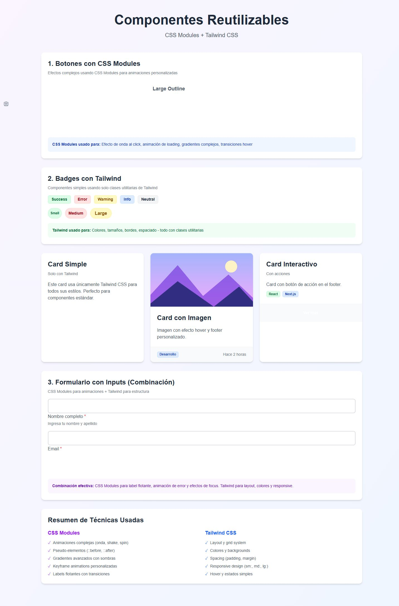
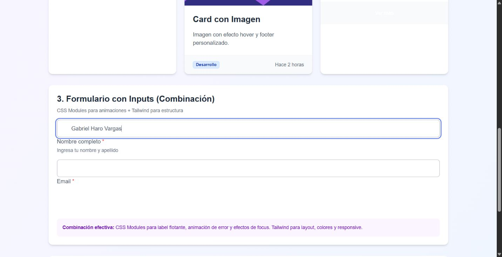
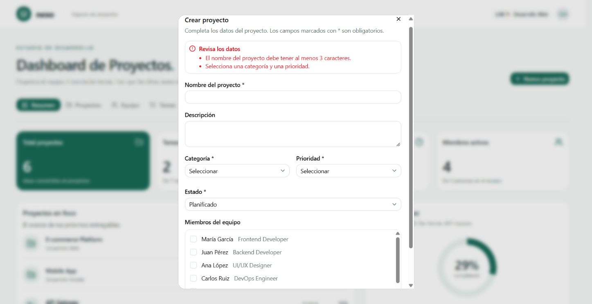
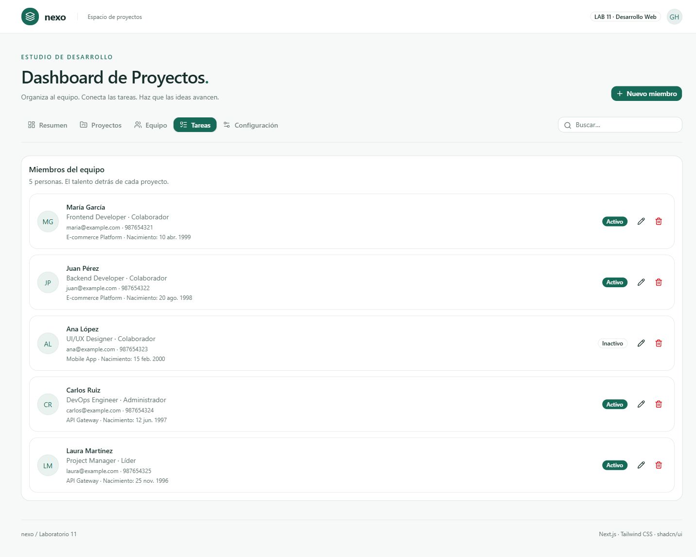
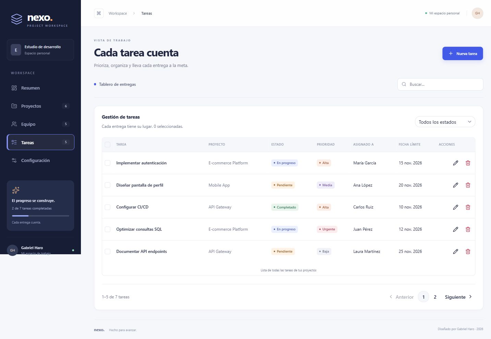
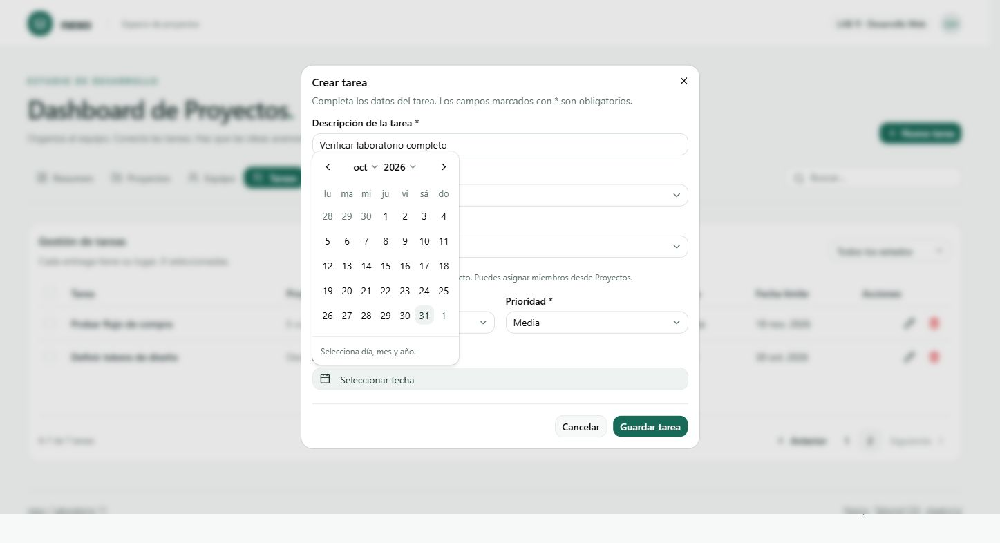
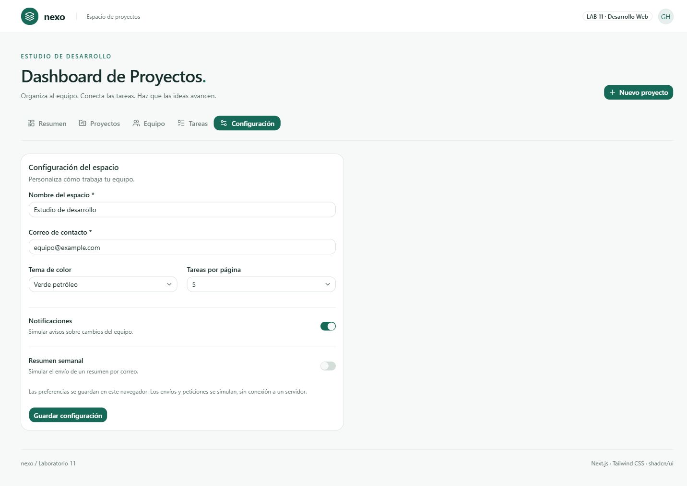

# Laboratorio 11 Componentes y estilización

Gabriel Haro Vargas · Desarrollo de Aplicaciones Web Avanzado · Laboratorio 11 · 31 de octubre de 2026

## Objetivo y resultado

Se desarrollaron dos aplicaciones independientes con Next.js 16.4.3, React 19.3.0, TypeScript y Tailwind CSS 4. El primer ejercicio demuestra componentes reutilizables. El segundo implementa un dashboard con shadcn/ui y la lógica de negocio solicitada en la tarea. El código compila, pasa ESLint y las nueve pruebas de reglas de negocio.

## Ejercicio 1 Componentes reutilizables

Button utiliza CSS Modules para el efecto de onda, gradientes, transiciones y spinner. Card y Badge emplean utilidades de Tailwind para estructura, colores y tamaños. Input combina etiqueta flotante y animación de error mediante CSS Modules con disposición adaptable y espaciado mediante Tailwind. Se corrigió la asociación entre etiquetas y campos, y se reforzó la validación del correo electrónico.

## Resultado de combinar CSS Modules y TailwindCSS

La combinación permite separar los efectos específicos del componente de las decisiones generales de diseño. Los módulos aíslan los estilos de onda, giro y etiqueta flotante para evitar colisiones entre componentes. Las utilidades de Tailwind permiten construir las tarjetas, rejillas, colores y tamaños sin escribir una hoja global extensa. En el formulario se observa esta integración: la etiqueta cambia de posición con CSS y el contenedor conserva la estructura responsive con clases utilitarias. Conviene reservar CSS Modules para los comportamientos visuales particulares y mantener el diseño habitual con Tailwind para facilitar el mantenimiento.

## Ejercicio 2 Componentes de shadcn ui

Se instalaron mediante el CLI oficial los componentes button, card, input, label, dialog, tabs, select, badge, avatar, switch, table, checkbox, spinner, alert, calendar, pagination, popover y textarea. Su código se encuentra en next-shadcn-ui/src/components/ui. Se utiliza una paleta verde petróleo y se ofrecen alternativas índigo y rosa en Configuración. La interfaz contiene las cinco secciones requeridas.

## Proyectos

Se implementaron creación, listado, edición, vista de detalles y eliminación. Cada proyecto tiene nombre, descripción, categoría, prioridad, estado y miembros del equipo. Los detalles muestran miembros, tareas y porcentaje de avance calculado. Se rechazan nombres duplicados y datos obligatorios incompletos. Al eliminar un proyecto se eliminan sus tareas y se conservan los miembros. Esta consecuencia se informa antes de confirmar.

## Equipo

Se implementó el CRUD de miembros con todos los campos solicitados: userId, role, name, email, position, birthdate, phone, projectId e isActive. El identificador se genera automáticamente. Se comprueba formato de correo, duplicados, teléfono y fecha de nacimiento anterior a hoy. El proyecto principal y la pertenencia a equipos se mantienen relacionados. Eliminar un miembro conserva las tareas, pero las deja sin responsable.

## Tareas y paginación

Se implementó el CRUD con description, projectId, status, priority, userId y dateline. Se utiliza projectId como nombre canónico del campo escrito prjectId en la guía. El responsable debe pertenecer al proyecto seleccionado. Hay búsqueda, filtro de estado, selección de filas y paginación real. La segunda página muestra los registros 6 y 7 de los siete iniciales; el tamaño puede cambiarse a 5, 10 o 20.

## Calendar Spinner y Alert

Calendar se utiliza para fecha de nacimiento y fecha límite, con selección de día, mes y año. Las operaciones de guardado y eliminación simulan una petición de 700 milisegundos con Spinner y bloqueo de envíos repetidos. Alert muestra validaciones y confirmaciones de guardado. No se conecta un backend real, conforme a la simulación solicitada.

## Configuración y resumen

Configuración guarda el nombre del espacio, correo, tema de color, tamaño de página, notificaciones y resumen semanal. El tema y la paginación se aplican a la interfaz; las preferencias de envío son simuladas. Resumen calcula proyectos, tareas completadas, tareas pendientes y miembros activos a partir de los datos actuales. El avance general es completadas dividido entre total de tareas; los datos iniciales producen 6 proyectos, 2 tareas completadas, 5 pendientes, 4 miembros activos y 29 % de avance. No se presentan horas trabajadas ficticias porque no existe un registro de horas.

## Persistencia y reglas de integridad

Los registros viven en memoria y además se conservan en localStorage bajo la clave lab11-nexo-v1. Recargar conserva los cambios en el mismo navegador. No existe una base de datos compartida entre usuarios. Al cambiar relaciones se evitan referencias a miembros o proyectos inexistentes. Los identificadores se generan con crypto.randomUUID y los porcentajes se calculan desde las tareas.

## Comprobaciones realizadas

Ambas aplicaciones respondieron HTTP 200 y completaron npm run build y npm run lint. Las nueve pruebas npm test verificaron métricas, creación y edición de proyectos, validaciones y fechas, CRUD de miembros, CRUD de tareas, pertenencia del responsable, eliminación en cascada, limpieza de responsables y retiro de miembros de proyectos. En navegador se verificaron CRUD de proyectos, miembros y tareas, persistencia tras recargar, paginación, actualización de métricas, calendario y guardado de configuración. En la galería se verificaron error de correo, carga simulada y alerta de envío válido. La revisión móvil y las capturas adicionales de Resumen, Proyectos y del árbol de componentes no se completaron al detenerse el control de la interfaz.

## Enlaces de entrega

- Repositorio GitHub: https://github.com/gabrielharo-dotcom/laboratorio11-componentes-dashboard

- Dashboard local: http://localhost:3000/dashboard

- Galería local: http://localhost:3001/styling

Vercel: publicación pendiente de reautenticación de la cuenta por correo. Se configuró el proyecto nexo-lab11 con raíz next-shadcn-ui, pero Vercel solicitó verificar un código antes de iniciar el despliegue. No hay una URL pública verificada y no se incluye un enlace inventado.

## Cinco conclusiones

1. La separación en componentes reutilizables permitió mantener la misma apariencia y comportamiento en varias secciones. Centralizar los controles y formularios evita repetir cambios y facilita corregir las validaciones.

2. CSS Modules y TailwindCSS se complementan cuando cada uno tiene una responsabilidad clara. Los efectos de onda, giro y etiqueta flotante permanecen aislados, mientras que Tailwind agiliza el diseño y el espaciado.

3. Instalar componentes de shadcn/ui proporciona una base útil, pero no resuelve por sí solo la lógica del sistema. Fue necesario implementar relaciones, validaciones, estados de carga y consecuencias de eliminación para que el dashboard fuera funcional.

4. Calcular las métricas desde los registros evita inconsistencias. Durante la prueba, completar una tarea incrementó el contador de tareas completadas de 2 a 3; eliminar la tarea de prueba restauró los valores correspondientes.

5. La persistencia local es adecuada para practicar una aplicación con datos en memoria y comprobar el flujo completo. Para un uso real con varios usuarios harían falta una API, una base de datos y control de acceso; las pruebas de integridad preparan esa evolución sin confundir la simulación con un backend real.